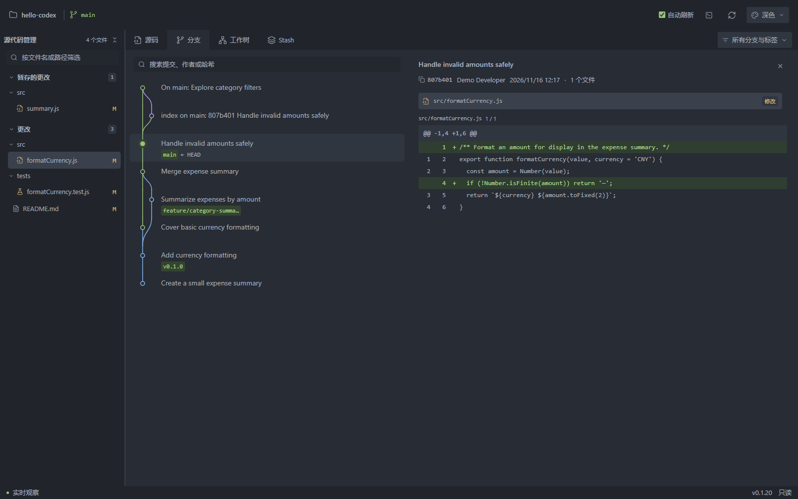
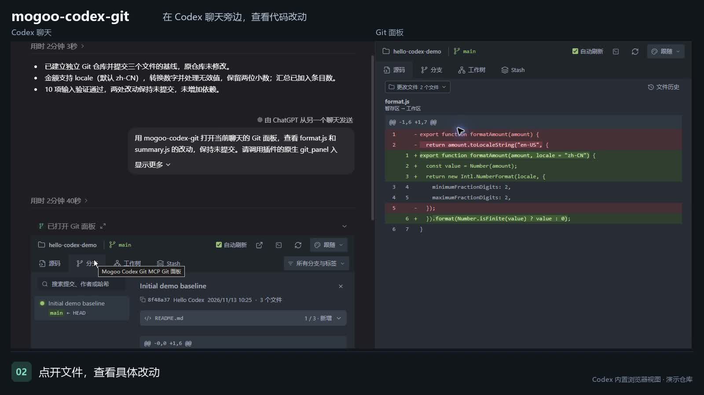

# mogoo-codex-git

**English** | [简体中文](README.zh-CN.md)

Review code changes beside your Codex chat.

mogoo-codex-git opens the repository or worktree associated with the current chat. Browse file diffs, commit history, branches, and Stash snapshots, then prepare a Git request in the chat draft when you want Codex to take the next step.



[26-second quick demo](docs/media/quick-demo.mp4) · [86-second full demo](docs/media/full-demo.mp4) · [Media and version notes](docs/media/README.md)

Screenshots show the actual browser view of the v0.1.20 candidate. Videos show the native Codex chat layout recorded with v0.1.18, with updated closing captions. All media uses a dedicated demo repository.

[](docs/media/quick-demo.mp4)

## Install

Requires Codex with the `codex plugin` commands, Git, and Node.js 22.12+. Windows is the currently validated platform; macOS and Linux have not completed runtime validation. The plugin includes the built UI and service, so users do not need pnpm or a manual build.

Ask a Codex agent that can install plugins:

```text
Please install this Codex plugin: https://github.com/MogooStudio/mogoo-codex-git
```

Or run:

```powershell
codex plugin marketplace add https://github.com/MogooStudio/mogoo-codex-git.git --ref main --json
codex plugin add mogoo-codex-git@mogoo-codex-git --json
codex plugin list --marketplace mogoo-codex-git --json
```

The repository is currently private; installation requires Git access to it. This uses a custom plugin marketplace. `MogooStudio/mogoo-codex-git` contains the source and the prebuilt plugin; installation and updates use this same GitHub repository. End users do not need to build the source. See the [plugin guide (Chinese)](codex/PLUGIN-README.md) for usage, updates, and removal.

## First use

1. Open a Codex chat for a Git project.
2. Select **Git 面板** in the chat sidebar, or ask Codex to open the mogoo-codex-git panel.
3. Open the **源码** tab and select a changed file to inspect its diff.

After switching chats or worktrees, open the panel from the corresponding chat. If the plugin is missing, start a new chat or restart Codex. A directory without a Git repository shows an empty state; the plugin does not initialize a repository.

## Features

- Working-tree and staged changes, with side-by-side and unified diffs.
- Commit graph, branch and tag filters, and keyword search within loaded commits.
- Rename-aware file history and line attribution for committed code.
- Worktree overview and read-only Stash snapshots.
- Codex theme integration, manual light/dark themes, and local refresh every 15 seconds while the panel is visible.
- Git request templates: copy, insert into the chat draft, or send after confirmation. The browser view supports copying; draft and send actions use the native Codex panel.

## Git browsing and data handling

Repository data is read locally. The browsing APIs do not stage, commit, switch branches, fetch, push, or upload repository contents. Git request templates are passed to Codex, which may then modify the repository according to the request.

Installation, updates, and version checks use the network. Automatic checks read GitHub release tags and can be disabled in the update settings. For a private repository, the plugin falls back to a read-only Git tag query using existing Git credentials. Background checks do not prompt for login or store credentials in the plugin. These statements describe the plugin, not the data handling of the entire Codex or AI platform.

- Remote status uses local remote-tracking references; browsing does not fetch.
- Search covers loaded history, up to 2,000 commits. Large diffs and untracked-file previews are limited.
- Repositories need a working tree. Submodules show commit-pointer changes. Image diffs are outside the current scope.
- The browser service listens locally. Its complete URL includes an authentication token; do not put token-bearing URLs or private code in public reports.

## Development

Requires Node.js 22.12+, Git, and pnpm 11.9.0. From this source directory:

```powershell
pnpm install --frozen-lockfile
pnpm check
```

`pnpm check` builds the UI, runs all tests, and verifies the bundled plugin. After changes to source, plugin documentation, or third-party notices, run `pnpm marketplace:sync` before checking. Do not edit generated files in `plugins/mogoo-codex-git/` directly.

See [development notes](docs/DEVELOPMENT.md) for authenticated preview links and optional UI checks, and [release notes for maintainers](docs/RELEASING.md) for packaging.

## Feedback and contributions

Reproducible bug reports, small fixes, and documentation improvements are welcome. Include the plugin version, Codex version, OS, installation source, and reproduction steps. Remove tokens, private paths, and real code first. Discuss substantial features before implementation. See [CONTRIBUTING.md](CONTRIBUTING.md).

## License

Original project code is licensed under [MIT](LICENSE). Third-party components and assets retain their own copyright and terms; see [THIRD-PARTY-NOTICES.md](THIRD-PARTY-NOTICES.md). GSAP / ScrollTrigger uses its own license and is not relicensed under this project's MIT License.
