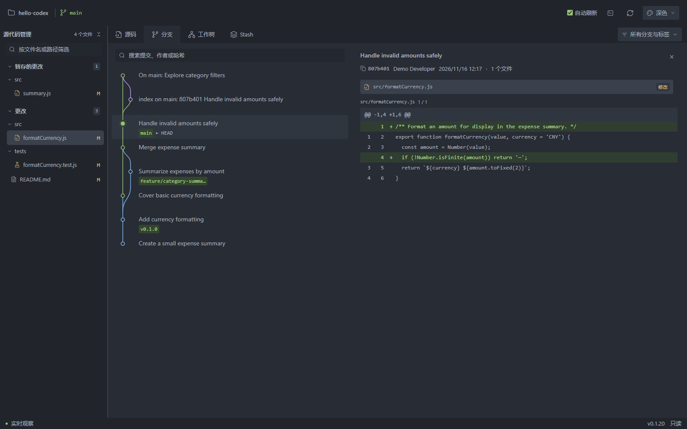
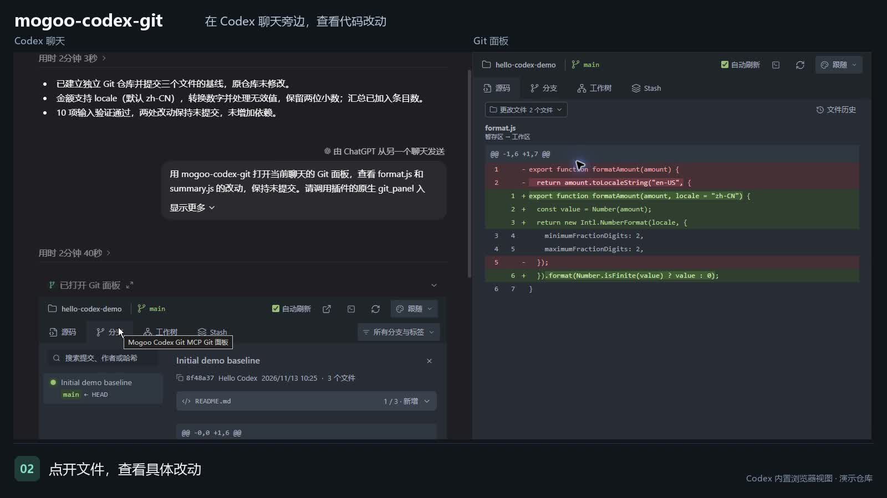

# mogoo-codex-git

[English](README.md) | **简体中文**

[网站](https://mogoostudio.github.io/mogoo-codex-git/)

在 Codex 聊天旁边，查看当前仓库的代码改动。

mogoo-codex-git 会关联当前聊天的仓库或 worktree，让你查看文件差异、提交历史、分支和 Stash。需要继续操作时，可以把常用 Git 请求填入聊天草稿，核对后交给 Codex 处理。



[26 秒快速演示](docs/media/quick-demo.mp4) · [86 秒完整演示](docs/media/full-demo.mp4)

[](docs/media/quick-demo.mp4)

## 安装

需要支持 `codex plugin` 命令的 Codex、Git 和 Node.js 22.12+。当前验证平台为 Windows；macOS / Linux 尚未完成运行验证。安装包内置构建后的界面和服务，使用者不需要 pnpm 或自行构建。

把这句话交给支持安装插件的 Codex Agent：

```text
请从 mogoo-codex-plugin 市场安装 mogoo-codex-git 插件，市场地址：https://gitee.com/mogoo/mogoo-codex-next-release.git
```

也可以在终端运行：

```powershell
codex plugin marketplace add https://gitee.com/mogoo/mogoo-codex-next-release.git --ref main --json
codex plugin add mogoo-codex-git@mogoo-codex-plugin --json
codex plugin list --marketplace mogoo-codex-plugin --json
```

这是自定义插件市场安装。`Mogoo Codex Plugin` 统一列出 Next 和 Git；Git 插件的源码、构建包和版本标签由 `MogooStudio/mogoo-codex-git` 提供。使用者无需构建源码。使用、更新和卸载见[插件说明](codex/PLUGIN-README.md)。

## 第一次使用

1. 在 Codex 中打开一个 Git 项目的聊天。
2. 点击聊天右侧的 **Git 面板**，或说“用 mogoo-codex-git 打开当前聊天的 Git 面板”。
3. 进入「源码」，点开一个变更文件，查看具体差异。

切换聊天或 worktree 后，在对应聊天重新打开面板。插件未显示时，新开聊天，必要时重启 Codex。没有 Git 仓库时会显示空状态，不会替你初始化仓库。

## 可以查看什么

- 工作区与暂存区的文件变更，左右对照和统一差异。
- 提交关系图、分支与标签筛选，以及已加载提交中的关键词搜索。
- 支持跟踪重命名的文件历史、已提交代码的行归属。
- 多工作树概览和只读 Stash 快照。
- 跟随 Codex 主题，或手动切换浅色 / 深色；面板可见时默认每 15 秒刷新本地状态。
- Git 常用语：选择常用操作描述，复制、填入聊天草稿，或核对后确认发送给 Codex。浏览器视图支持复制；草稿与发送使用 Codex 原生面板。

## Git 浏览与数据处理

官网使用 Clarity 统计访问来源、安装入口点击和复制结果，见[网站统计说明](docs/ANALYTICS.md)。统计不接入插件或本机 Git 面板。

Git 浏览数据在本机读取。插件的浏览接口不会暂存、提交、切换分支、fetch 或推送，也不会上传仓库内容。「Git 常用语」会把你选择的请求交给 Codex，后续处理可能修改仓库。

安装、更新和版本检查需要联网。自动检查读取 GitHub 发行标签，可以在插件更新设置中关闭。HTTP 连接失败或仓库需要认证时，会复用 Git 的代理和凭据配置只读查询标签；后台检查不弹出登录提示，也不在插件中存储凭据。以上说明针对插件自身，不扩大为对 Codex / AI 平台整体数据行为的承诺。

- 远程状态来自本机远程跟踪引用，查看面板不会自动 fetch。
- 搜索覆盖已加载历史，最多 2,000 条提交；大文件差异和未跟踪文件预览有大小限制。
- 面板适用于带工作区的仓库；子模块展示提交指针变化。图片差异不在当前范围内。
- 浏览器入口仅监听本机，完整链接包含鉴权令牌。不要将令牌链接或真实仓库内容放入公开反馈。

## 开发

需要 Node.js 22.12+、Git 和 pnpm 11.9.0。在源码目录运行：

```powershell
pnpm install --frozen-lockfile
pnpm check
```

`pnpm check` 会构建前端、运行全部测试，并核对仓库内的插件分发包。修改源码、插件说明或第三方声明后，先运行 `pnpm marketplace:sync` 生成分发包，再执行检查；不要直接编辑 `plugins/mogoo-codex-git/` 中的生成文件。

开发服务、带令牌的预览链接和可选界面检查见[开发说明](docs/DEVELOPMENT.md)。维护者的打包流程见[发布说明](docs/RELEASING.md)。

## 反馈与贡献

欢迎报告可复现的问题、小修复和文档改进。反馈时请附插件版本、Codex 版本、系统、安装来源和复现步骤；先去掉令牌、私有路径和真实代码。大功能建议先讨论范围，再提交实现。详见[贡献说明](CONTRIBUTING.md)。

## 许可

项目原创代码采用 [MIT](LICENSE) 许可证。第三方组件和素材保留各自的版权与许可，详见 [THIRD-PARTY-NOTICES.md](THIRD-PARTY-NOTICES.md)。GSAP / ScrollTrigger 使用自己的许可，不属于本项目的 MIT 授权范围。
